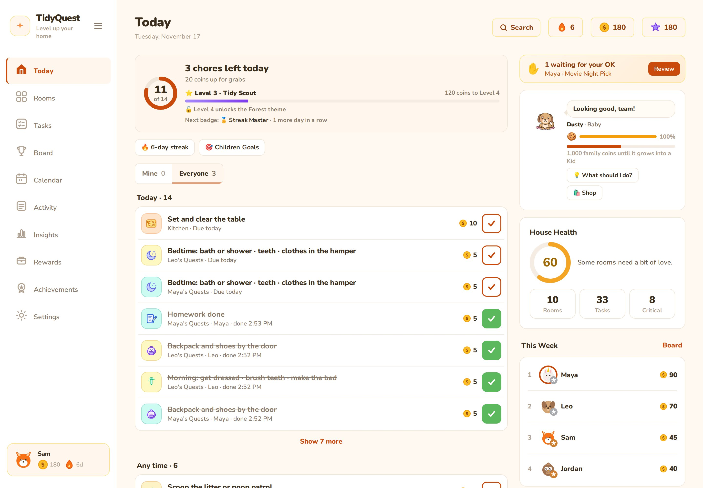
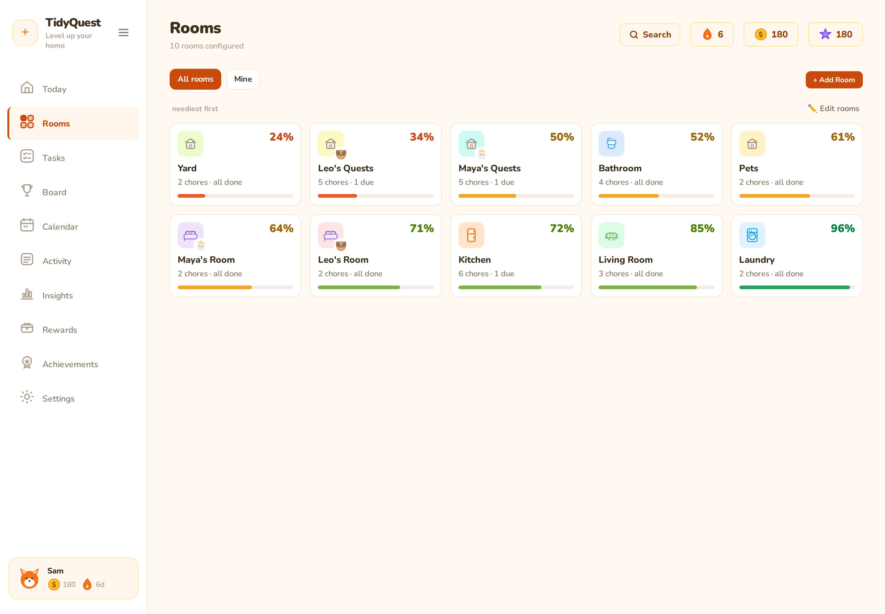
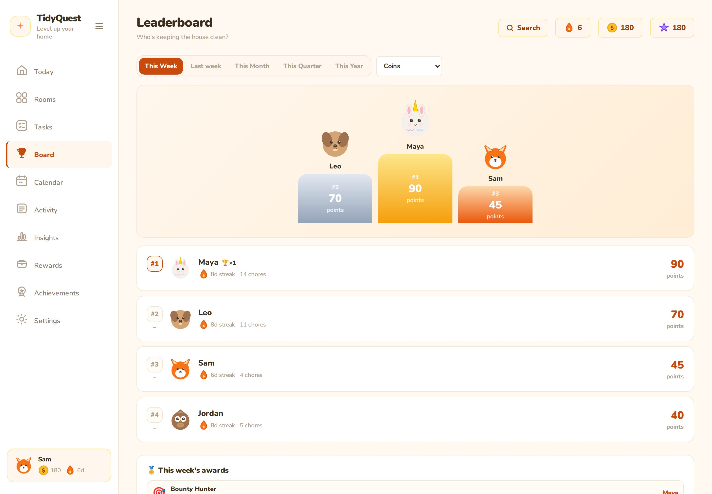
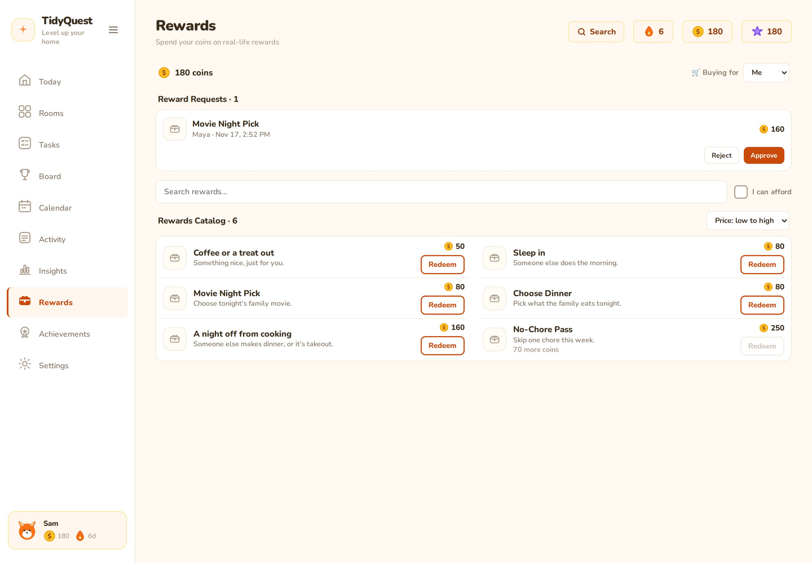
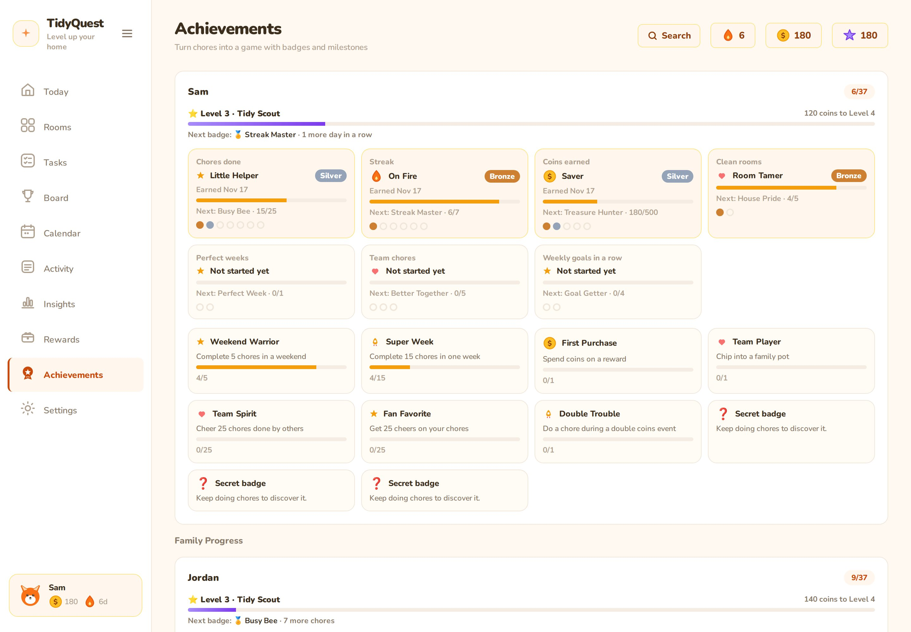

# 🏠 TidyQuest

> Turn household chores into a family game

**TidyQuest** is a self-hosted web app for sharing out the housework. Chores come due on a schedule, everyone earns
coins for doing them, and the coins buy real-life rewards your family picks.

[](https://github.com/TidyQuest/TidyQuest/releases)


> [!WARNING]
> **Early-stage project.** TidyQuest changes quickly. Back up your data before updating, and
> [open an issue](https://github.com/TidyQuest/TidyQuest/issues) if something breaks.

---

## ✨ What it does

- **🧹 Chores that come due.** Every few days, on set weekdays, monthly ("first Saturday"), or once as a to-do.
  Each chore has a health bar that drops until someone does it. Rooms, zones, icons and a countdown timer.
- **💰 Coins and rewards.** Coins for every chore, a reward shop with your own prices, weekly goals with a bonus, and parents'
  OK for kids' purchases. Chores can be shared or split between people.
- **🎮 Game extras.** Streaks and streak shields, levels and badges, a family leaderboard, team-ups, cheers, double
  coins, a daily Rescue Mission, and a house mascot that grows as the family earns.
- **👨‍👩‍👧 Made for families.** Parent, member and child roles, a simpler Kid mode, Strict Mode (a parent approves
  kids' chores, with an optional proof photo), vacation pauses, and family members who don't log in.
- **📊 Insights for parents.** Who does what, when chores get done, and which ones keep slipping.
- **🔔 Notifications.** On each person's own phone (web push), or through Telegram, ntfy or Home Assistant, with
  quiet hours.
- **📱 Phone first.** Add it to the home screen and it opens like an app. Six languages (English, French, German,
  Spanish, Italian, Dutch), color themes, and a built-in guide (Settings → Guide & help).

Every extra can be switched off in **Settings → Features**, so a family can keep it as simple or as playful as it
likes.

## 📸 Screenshots

<details>
<summary>Click to view screenshots</summary>

### Today

*Today's chores for the whole family, level progress, house health and this week's leaders*

### Rooms

*Every room's health at a glance, neediest first*

### Leaderboard

*Family rankings for this week, last week, the month, the quarter or the year*

### Rewards

*Spend coins on real-life rewards; kids' requests wait for a parent's OK*

### Achievements

*Levels, and badges that grow from bronze to silver and beyond*

</details>

---

## 🚀 Install

You need Docker. TidyQuest is one container with its data in one folder.

**Docker Compose.** Save this as `docker-compose.yml`:

```yaml
services:
  tidyquest:
    image: tidyquest/tidyquest:latest   # or ghcr.io/tidyquest/tidyquest:latest
    container_name: tidyquest
    ports:
      - "3020:3000"
    environment:
      - JWT_SECRET=CHANGE_ME   # a long random string: openssl rand -base64 32
    volumes:
      - ./data:/app/data
    restart: unless-stopped
```

Then run `docker compose up -d` and open **http://localhost:3020**.

**Unraid.** Search for **TidyQuest** in Community Applications, fill in `JWT_SECRET`, and install.

**From source.** `git clone` this repository, copy `.env.example` to `.env`, set `JWT_SECRET`, and run
`docker compose up -d --build`.

**First login.** The first account you register is the family's parent (admin). A setup wizard then helps you add
rooms, chores and family members.

> [!IMPORTANT]
> Put TidyQuest behind an HTTPS reverse proxy (Caddy, Nginx Proxy Manager…) before opening it to the internet.
> Phone notifications and "add to home screen" also need `https://`. See [SECURITY.md](SECURITY.md).

## 🔧 Configuration

Most settings live in the app. The environment variables you're most likely to need:

| Variable | What it's for |
|----------|---------------|
| `JWT_SECRET` | **Required.** Signs logins. At least 32 random characters |
| `TRUST_PROXY` | Behind a reverse proxy: its addresses (e.g. `loopback, 172.16.0.0/12`) or a hop count like `1` |
| `TZ` | Fallback time zone. The family's zone is set in Settings → General → Time zone |
| `ADMIN_RESET_PASSWORD` | Forgot the parent password? Set it, restart, then remove it and restart again |
| `SOURCE_URL` | If you run a changed copy: where people can get your code (the AGPL asks for this) |

The full list, and setup steps for Telegram, ntfy and Home Assistant notifications, are in
[docs/configuration.md](docs/configuration.md).

## 🔄 Updating and backups

```bash
docker compose pull && docker compose up -d
```

Your data stays in `./data` and updates itself on start. Before updating, take a backup: **Settings → Export Data**
(a JSON file you can load back with Import Data), or copy the `data` folder.

Still on the old `mellowfox/tidyquest` image? It stopped at 0.6.3. Change the image to `tidyquest/tidyquest:latest`
(on Unraid, the container's *Repository*) and pull. What changed in each version: [CHANGELOG.md](CHANGELOG.md).

## 🏠 Home Assistant

The integration in [`custom_components/tidyquest`](custom_components/tidyquest/README.md) shows each chore as a
sensor and adds services to complete, reset, create and edit chores from dashboards and automations.

## 🛠️ For developers

React 19 + Vite on the front, Node.js + Express + TypeScript and SQLite on the back, in a single Docker image. The
API is described in [API.md](API.md). Contributions are welcome: fork, make a branch, and open a pull request.

## 📜 License

[AGPL-3.0](LICENSE). You can use, change and share TidyQuest freely. If you run a changed copy for other people,
even privately, you must share your changed code with them.

## 🙏 Thanks

Created by [mellow-fox](https://github.com/mellow-fox) and moved to the TidyQuest organization in November 2026.
Uses the [Nunito](https://fonts.google.com/specimen/Nunito) font.

**Help:** [Issues](https://github.com/TidyQuest/TidyQuest/issues) ·
[Discussions](https://github.com/TidyQuest/TidyQuest/discussions) · security reports: see [SECURITY.md](SECURITY.md)
